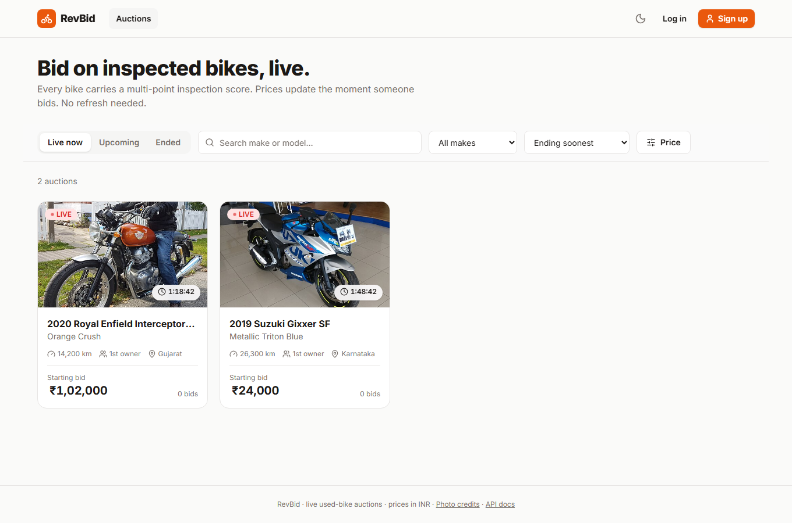
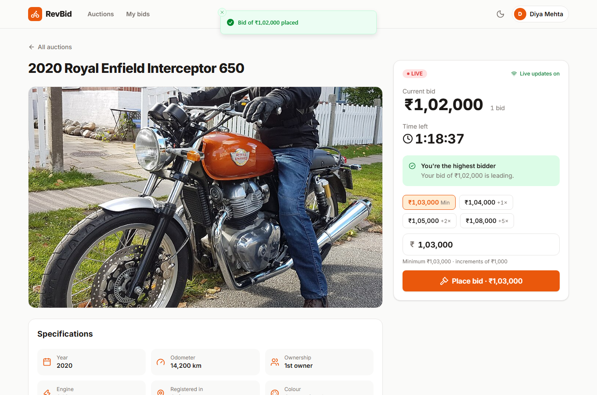
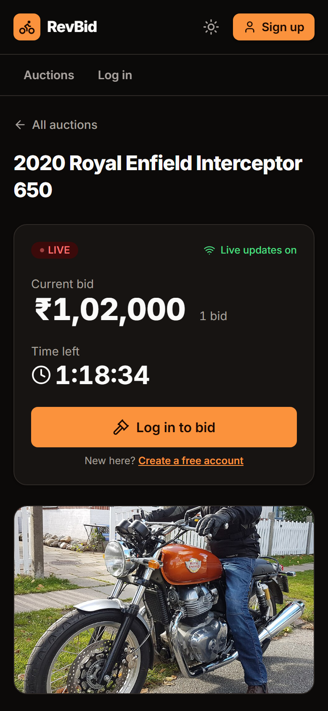
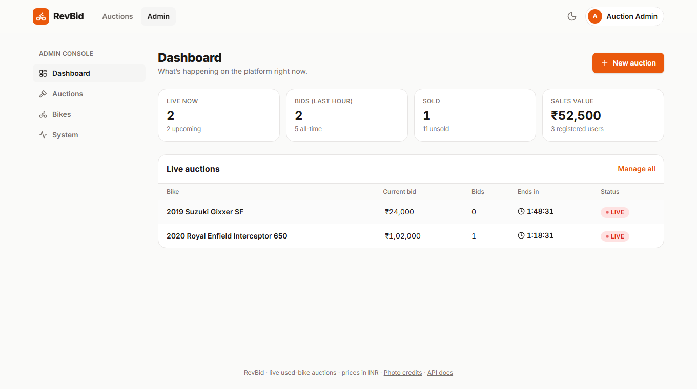

# RevBid: live used-bike auctions

A production-minded auction platform where registered users bid on inspected used motorcycles in **real time**,
across many simultaneous auctions, with a full lifecycle (draft → scheduled → live → sold/unsold/cancelled), an admin
console, and the operational tooling you'd expect in production: structured logs, Prometheus metrics, health checks,
alerts, a provisioned Grafana dashboard, CI and containers.

> **Live demo:** https://revbid.vercel.app (API: https://revbid-api.onrender.com, docs at `/docs`). The API runs on a free
> tier and may take 30-60 seconds to wake on the first visit. Deployment steps: [docs/DEPLOYMENT.md](docs/DEPLOYMENT.md).
>
> **Demo accounts** (also shown on the login page):
>
> | Role | E-mail | Password |
> |---|---|---|
> | Administrator | `admin@bikeauction.dev` | `Admin@12345` |
> | Bidder | `buyer1@bikeauction.dev` | `Buyer@12345` |
> | Bidder | `buyer2@bikeauction.dev` | `Buyer@12345` |
>
> Tip: open the same auction in two private windows as the two bidders and watch bids, outbid notices and the
> anti-sniping countdown update live.

## Screenshots

| Browse live auctions | Live auction page (after placing a bid) |
|---|---|
|  |  |

| Mobile, dark theme | Admin console |
|---|---|
|  |  |

## What it does

**For bidders**
- Browse live / upcoming / ended auctions with search, make, price and sort filters (shareable URLs, keyset pagination)
- Live auction page: price that flashes on every bid, a **server-synchronised countdown** that turns urgent in the last
  5 minutes / minute, quick-bid chips, bid history with anonymous per-auction aliases, "you're winning / you've been outbid" state
- Instant **outbid** and **won** notifications; a *My bids* page (active / won / closed)
- Race-aware errors ("Someone just bid higher. The minimum is now ₹51,500"), idempotent retries, a confirmation for suspiciously large bids
- Light/dark theme, mobile-first, keyboard and screen-reader friendly (live regions, labelled controls, skip link)

**For administrators**
- Dashboard (live auctions, bids/hour, sales), bike catalogue CRUD, auction creation wizard (pricing, reserve, schedule, anti-sniping)
- Live auction monitor with the full **audit trail**, cancellation with a reason
- **System** page: dependency health with latency, open sockets, bids/min, scheduler liveness

**Platform behaviour**
- **Correct under concurrency:** every bid is validated under a per-auction row lock against the database clock; the schema
  makes duplicate winners impossible; retries are idempotent
- **Fair:** anti-sniping extensions (capped), hidden reserve, anonymous bidders, one clock authority
- **Resilient:** the system keeps bidding correct if Redis is down, if the scheduler sleeps (free hosting), or after a restart

## Tech stack

| | |
|---|---|
| Backend | Python 3.11, **FastAPI**, SQLAlchemy 2 (async), Alembic, **PostgreSQL**, **Redis** (pub/sub + rate limits), structlog, Prometheus |
| Frontend | **React 19 + TypeScript**, Vite, Tailwind CSS 4, TanStack Query, React Router, react-hook-form + zod, Radix primitives |
| Realtime | WebSockets with Redis fan-out; a resilient client (backoff + jitter, resync, heartbeat) |
| Quality | pytest (real Postgres/Redis), Vitest, Playwright, ruff, mypy `--strict`, ESLint, GitHub Actions |
| Ops | Docker, docker-compose, Prometheus + Grafana, Render + Vercel |

## Quick start

**Everything in Docker** (needs only Docker Desktop):

```bash
docker compose up --build        # open http://localhost:8080
```

**Local development** with hot reload (Python 3.11, Node 22):

```bash
docker compose up -d db redis                                   # Postgres :5433, Redis :6380
cd backend && python -m venv .venv && source .venv/bin/activate # Windows: .venv\Scripts\Activate.ps1
pip install -r requirements-dev.txt
python -m alembic upgrade head && python -m scripts.seed
DEMO_MODE=true python -m uvicorn app.main:create_app --factory --reload --port 8100
# second terminal
cd frontend && npm ci && npm run dev                            # http://localhost:5173
```

Also available: `make help` (macOS/Linux/WSL), and `docker compose --profile observability up -d` for
Prometheus (:9090) and Grafana (:3000). Full instructions, Windows notes and troubleshooting:
**[docs/DEPLOYMENT.md](docs/DEPLOYMENT.md)**.

API documentation (OpenAPI/Swagger) is served at `/docs` (e.g. http://localhost:8100/docs).

## Testing

```bash
cd backend  && pytest --cov=app           # 237 tests, ~97% coverage; unit tests need no services
cd frontend && npm test                   # 64 unit/component tests
cd frontend && npm run e2e                # 13 Playwright browser tests against the running stack
```

The concurrency suite deserves a mention: it fires 30 simultaneous identical bids, 120-bid storms, parallel auctions,
duplicate idempotent retries and a close-vs-bid race against real Postgres, asserting *invariants* (strictly increasing
amounts, price == max bid, counts agree, nothing committed after close). Removing the row lock makes 5 of its 7 tests
fail, so the tests demonstrably catch the bug they exist for. Details in
[docs/ARCHITECTURE.md §10](docs/ARCHITECTURE.md#10-testing-strategy).

A load test (`loadtest/run.py`) drives hundreds of bidders and WebSocket spectators and re-verifies correctness; results
are in [docs/ARCHITECTURE.md §11](docs/ARCHITECTURE.md#11-load-test-results).

## Repository map

```
backend/            FastAPI app (api → services → domain), Alembic migrations, seed script, tests
  app/domain/       pure business rules: state machine, bidding rules, masking (no I/O)
  app/services/     transactional use cases: bids, auctions, lifecycle, auth
  app/realtime/     WebSocket hub, protocol, Redis fan-out
  app/workers/      lifecycle scheduler, demo replenisher
frontend/           React SPA, unit tests, Playwright E2E, nginx/Docker, vercel.json
deploy/             Prometheus config + alert rules, Grafana provisioning + generated dashboard, Postgres init
loadtest/           asyncio load test with post-run correctness verification
docs/               ARCHITECTURE.md · DEPLOYMENT.md · ASSUMPTIONS.md
render.yaml         Render blueprint (API + Postgres + Redis)
.github/workflows/  CI (lint, types, tests, E2E, images, audit) and a keep-alive ping
```

## Documentation

- **[Architecture & design](docs/ARCHITECTURE.md):** the design, the reasoning, diagrams, scaling path, decision log
- **[Deployment](docs/DEPLOYMENT.md):** Docker, local dev, Render + Vercel step by step, configuration reference, troubleshooting
- **[Assumptions & trade-offs](docs/ASSUMPTIONS.md):** what was assumed, what was traded away, and known limitations

Photo credits for the demo listings: see `/credits` in the app (CC-licensed images from Wikimedia Commons).
