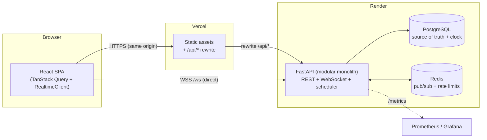
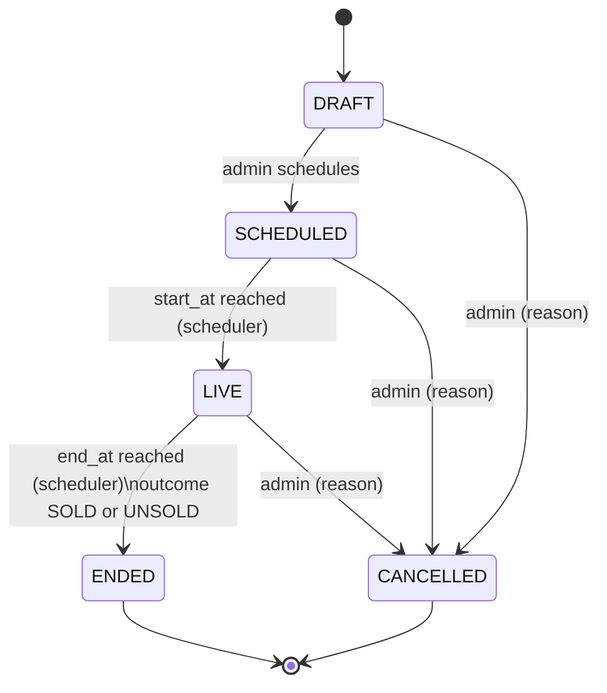
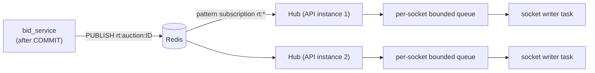

# Architecture & design

This document explains **how the system works and why it is built this way**. The decisions that
matter most (bid correctness, real-time delivery, lifecycle, free-tier operation) come first; each
section ends with the trade-off that was accepted. Companion docs:
[ASSUMPTIONS.md](ASSUMPTIONS.md) (assumptions and trade-offs in one list) and
[DEPLOYMENT.md](DEPLOYMENT.md).

- [1. Goals and non-goals](#1-goals-and-non-goals)
- [2. System overview](#2-system-overview)
- [3. Data model](#3-data-model)
- [4. Bid placement: the part that must never be wrong](#4-bid-placement-the-part-that-must-never-be-wrong)
- [5. Auction lifecycle](#5-auction-lifecycle)
- [6. Real-time delivery](#6-real-time-delivery)
- [7. Security](#7-security)
- [8. Observability](#8-observability)
- [9. Scalability](#9-scalability-what-scales-how-and-what-breaks-first)
- [10. Testing strategy](#10-testing-strategy)
- [11. Load test results](#11-load-test-results)
- [12. Decision log](#12-decision-log)

---

## 1. Goals and non-goals

| Goal | How it is addressed |
|---|---|
| Many simultaneous auctions | Per-auction row locking: auctions never contend with each other (see §4, §9) |
| Real-time bidding | WebSocket fan-out through Redis pub/sub; at-most-once with version-based self-healing (§6) |
| Auction lifecycle management | Explicit state machine + a lock-safe scheduler; correctness independent of the scheduler's timeliness (§5) |
| Fair and trustworthy | One clock authority (the database), anti-sniping, bidder anonymity, hidden reserve, audit trail |
| Production-grade operations | Structured logs, Prometheus metrics, health/readiness, alert rules, provisioned dashboard, graceful shutdown |
| Quality | 237 backend tests (97 % coverage, real Postgres/Redis), 64 frontend tests, 13 browser E2E tests, strict typing, CI |

**Non-goals** (deliberately out of scope; see ASSUMPTIONS.md): payments/escrow, KYC, e-mail/SMS
notification delivery, multi-seller marketplace, proxy/auto-bidding, image upload to object storage.

---

## 2. System overview



**Why this shape**

- **A modular monolith, not microservices.** One deployable with strict internal layering
  (`api → services → domain`, with `domain` pure and I/O-free). The core invariant (a bid is validated
  against the true latest auction state) wants one transaction boundary; splitting services would
  turn it into a distributed-consistency problem for no benefit at this scale. The seams
  (`realtime/`, `workers/`) are where it would be cut later.
- **Same-origin REST, direct WebSocket.** Vercel proxies `/api/*` to Render, so the browser sees one
  origin and the httpOnly refresh cookie works even where third-party cookies are blocked. Vercel cannot
  proxy WebSockets, so `/ws` goes straight to Render and authenticates with the in-memory access
  token (no cookie needed).

### Backend layers

```
backend/app/
  api/        HTTP + WebSocket edges: routing, dependencies, request/response schemas. No business logic.
  services/   Use cases that own a transaction: bid_service, auction_service, lifecycle_service, auth_service
  domain/     PURE rules, no I/O: auction_state (state machine), bidding_rules, masking
  realtime/   Hub (rooms + Redis fan-out), WebSocket protocol, event envelope, publisher
  workers/    Scheduler loop, demo-mode replenisher
  core/       config, security, logging, metrics, middleware, errors, rate limiting, clock, shutdown
  models/ db/ SQLAlchemy 2.0 async models, session factory
```

The dependency rule is enforced by convention and visible in the tests: `tests/unit` exercises
`domain/` with no database at all and runs in about a second.

---

## 3. Data model

```mermaid
erDiagram
  USERS ||--o{ BIDS : places
  USERS ||--o{ REFRESH_TOKENS : owns
  BIKES ||--o{ AUCTIONS : "listed in"
  AUCTIONS ||--o{ BIDS : receives
  AUCTIONS ||--o{ AUCTION_EVENTS : "audit trail"
  USERS { uuid id PK; string email UK; string password_hash "argon2id"; string role "BIDDER|ADMIN"; bool is_active }
  BIKES { uuid id PK; string make; string model; int year; int km_driven; int owner_number; int inspection_score; jsonb images }
  AUCTIONS {
    uuid id PK; uuid bike_id FK; string status; string outcome
    timestamptz start_at; timestamptz end_at; timestamptz original_end_at
    bigint starting_price; bigint reserve_price "hidden from bidders"; bigint min_increment
    bigint current_price "denormalised"; uuid leader_id "denormalised"; int bid_count "denormalised"; int version
  }
  BIDS { uuid id PK; uuid auction_id FK; uuid bidder_id FK; bigint amount; string idempotency_key }
  AUCTION_EVENTS { bigint id PK; uuid auction_id FK; string type; jsonb payload }
  REFRESH_TOKENS { uuid id PK; uuid user_id FK; uuid family_id; string token_hash; timestamptz revoked_at }
```

Design points:

- **Money is integer paise (`BIGINT`).** No floats anywhere in the API, database or UI math.
- **Denormalised hot fields** (`current_price`, `leader_id`, `bid_count`, `version`) are written only while
  holding the auction's row lock, so list pages never aggregate the bids table.
- **The schema is a second line of defence**, not just storage. These constraints make several bugs
  *impossible* rather than merely unlikely:
  - `UNIQUE(auction_id, amount)`: two bids for the same amount can never coexist
  - `UNIQUE(bidder_id, idempotency_key)`: a retried request cannot create a second bid
  - partial `UNIQUE(bike_id) WHERE status IN ('DRAFT','SCHEDULED','LIVE')`: a bike is never in two open auctions
  - `CHECK` constraints on status/outcome enums, `end_at > start_at`, `current_price >= starting_price`, `reserve >= starting`
- `auction_events` is an **append-only audit trail** (created, scheduled, every bid, extension,
  ended, cancelled) shown to admins and used by the concurrency tests as the authoritative ordering.
- Indexes follow the queries: `(status, end_at)` for the scheduler and "ending soon", `(status, start_at)`
  for promotion, `(bidder_id, created_at DESC)` for "my bids", and the unique `(auction_id, amount)` doubles as the
  bid-history keyset index.

---

## 4. Bid placement: the part that must never be wrong

```mermaid
sequenceDiagram
  autonumber
  participant C as Client
  participant A as API (bid_service)
  participant P as PostgreSQL
  participant R as Redis
  participant W as Other clients (WebSocket)
  C->>A: POST /auctions/{id}/bids {amount}  + Idempotency-Key
  A->>A: rate-limit check, JWT -> principal (no DB hit)
  A->>P: BEGIN; SELECT ... FROM auctions WHERE id=? FOR UPDATE
  Note over P: serialises bids on THIS auction only
  A->>P: SELECT clock_timestamp()  (after the lock)
  A->>A: validate (pure rules): LIVE? now < end_at? not leader? amount >= floor? idempotent replay?
  A->>P: INSERT bid; UPDATE auction (price, leader, count, version+1, maybe end_at); INSERT audit event
  A->>P: COMMIT (lock released)
  A->>R: PUBLISH bid_placed (rooms: auction, lobby) + outbid (previous leader)
  A-->>C: 201 {bid, auction snapshot}
  R-->>W: fan-out to every API instance, then to subscribed sockets
```

### Why a row lock

Every bid takes `SELECT ... FOR UPDATE` on the auction row as its first statement. That serialises
bids *per auction* and leaves all other auctions fully parallel. Everything the rules need (price,
leader, end time) is read **under that lock**, so a bid is always validated against the true latest
state: there is no check-then-act race to reason about.

Alternatives considered: optimistic concurrency with a version column and retry (more round trips and
retry storms on exactly the hot auctions where it matters), Redis Lua or a per-auction queue (extra
moving part and a second source of truth to reconcile), `SERIALIZABLE` isolation (serialisation
failures under contention). The row lock is the simplest option that is *provably* correct, and its
throughput ceiling (§11) is far above what one auction can plausibly generate.

### One clock, taken at the right moment

All time-dependent rules read time from the **database**, via `clock_timestamp()` *after* the lock is
held. Two subtleties:

1. App servers and clients can disagree on the time; only Postgres gives every instance the same "now".
2. `now()` is frozen at transaction start, so a bid that waited on the lock would see a stale time.
   `clock_timestamp()` after acquisition cannot.

The clock is behind an interface (`core/clock.py`); tests inject a `FakeClock`, so every timing rule
(snipe windows, close, reserve) is tested deterministically without sleeping.

### Rules (all in `domain/bidding_rules.py`, pure and unit-tested)

- Auction must be `LIVE` **and** `now < end_at`. The clock, not the scheduler, decides when bidding stops:
  a lagging or sleeping worker can never let a late bid through.
- The first bid may equal the starting price; later bids must beat the current price by `min_increment`.
- The current leader cannot outbid themselves; administrators cannot bid; a sanity cap guards fat-finger amounts.
- **Anti-sniping:** a bid in the final `snipe_window_s` extends `end_at` to `now + snipe_extension_s`,
  capped at `original_end_at + max_extension_s` so an auction cannot be extended forever.
- **Idempotency:** the client sends an `Idempotency-Key` per click. A retry (network blip, double click)
  returns the original bid and publishes nothing; reusing a key for a different bid is a `409`.

### Errors are part of the API

Every rejection is an RFC 7807 problem document with a **stable `code`** (`BID_TOO_LOW`,
`ALREADY_HIGHEST`, `AUCTION_ENDED`, ...) and actionable data (`min_next_bid`), so the UI can say
"Someone just bid higher. The minimum is now ₹51,500" instead of a generic failure.

### Privacy

Bidders are anonymous to each other: a per-auction alias (`Bidder-4F2A1`) derived from
`(auction_id, user_id)`: stable within an auction (you can follow a rival), different across auctions
(no cross-auction profiling). The reserve price is never serialised to non-admins (separate response
schemas, covered by a test that greps the public payloads for the number); only a boolean
`reserve_met` is exposed.

---

## 5. Auction lifecycle



- The transition table lives in `domain/auction_state.py` as pure data; every pair of states is
  tested (all 25 state pairs, parametrised), and every service calls `assert_transition` before mutating.
- **Outcome:** the leader wins iff the reserve (if any) is met, otherwise `UNSOLD`.
- **Scheduler** (`workers/scheduler.py`, ~1 s loop):
  - promote: `SCHEDULED → LIVE` where `start_at <= now`
  - close: `SELECT ... WHERE status='LIVE' AND end_at <= now FOR UPDATE SKIP LOCKED`, one auction per
    transaction, then publish `auction_ended` and a private `auction_won`
- **Close vs. last-second bid** is resolved by the *same row lock* bids use. If a bid commits first it
  may extend `end_at`, and the closer's `WHERE end_at <= now` no longer matches the re-read row; if the
  closer commits first, the bid sees `ENDED` and is rejected. `SKIP LOCKED` means an instance never waits on
  a row another holds, so any number of instances can run the loop safely. A dedicated race test hammers
  this boundary with real concurrency (including a "sniping war"), asserting no bid is ever committed after
  the close.
- **The free-tier problem, solved structurally.** Render's free instances sleep when idle. Because the bid
  path rejects bids after `end_at` by itself and the scheduler catches up on its first tick after waking
  (one test simulates 3 hours of downtime and checks everything overdue is settled in a single tick), a
  sleeping worker only delays *announcements*, never correctness. A scheduled GitHub Action pings
  `/healthz` to make cold starts rare.
- `RUN_SCHEDULER=false` lets the loop be split into its own process when the deployment grows.

---

## 6. Real-time delivery



- **Rooms:** `auction:{id}` (everything about one auction), `lobby` (compact list updates), and the private
  `user:{id}` (outbid/won notices, joined automatically after `auth`).
- **Horizontal scaling:** each process keeps in-memory rooms and exactly one Redis pattern subscription; a
  publish from any instance reaches every instance. No sticky sessions needed.
- **Publish happens after COMMIT and is best-effort.** The bid is already durable, so a Redis outage must never
  fail or roll back a bid (a test replaces Redis with a dead one and asserts a `201`). The failure is counted
  and alerted on.
- **Delivery is at-most-once by design**, and self-healing:
  every event carries the auction's monotonically increasing `version`. Clients ignore any event whose
  version is not newer than the state they hold (so duplicates and reordering are harmless) and re-fetch the
  REST snapshot after any reconnect or `resync` message. The alternative (transactional outbox plus ordered
  streaming) is the documented next step; it buys exactly-once-ish delivery that this UI does not need.
- **Back-pressure:** the Redis listener must never block on a slow client. Each connection owns a bounded
  queue and a dedicated writer task; a full queue drops *that* connection (counted by reason), and the client
  reconnects and resyncs.
- **Protection:** per-user connection cap, inbound token-bucket rate limit, 4 KB frame limit (plus a protocol-level
  `--ws-max-size`), Origin allowlist, subscription cap, strict room-name validation (a client can never subscribe to
  another user's private room).
- **Client resilience** (`frontend/src/lib/realtimeClient.ts`, unit-tested with a fake socket): exponential backoff
  with jitter (no thundering herd after a deploy), re-auth and re-subscribe on every open, ping plus a watchdog that
  detects half-open connections, reconnect on tab-visible/online, reference-counted subscriptions.
- **Countdowns use server time.** Every payload carries `server_time`; the client keeps a smoothed offset and
  computes deadlines against it, so a wrong device clock cannot mislead a bidder.
- **Shutdown can't hang.** A bug found by stress-testing (the Redis listener task could ignore cancellation
  and stall shutdown) led to polling with a bounded timeout and time-boxing every shutdown step
  (`core/shutdown.py`), covered by a 300-cycle start/stop stress check and unit tests.

---

## 7. Security

| Area | Control |
|---|---|
| Passwords | Argon2id; constant-time-ish login (a dummy hash is verified for unknown e-mails); strength rules; generic error messages |
| Sessions | 15-min JWT access token held **in memory** (nothing to steal from storage); opaque **rotating** refresh token in an `httpOnly; Secure; SameSite` cookie scoped to `/api/v1/auth`, stored hashed; **reuse detection** revokes the whole token family (with a short grace window so two tabs refreshing together are not mistaken for theft); logout revokes the family |
| Algorithm confusion | JWT `alg` is pinned server-side (`alg=none` and wrong-type tokens are tested) |
| AuthZ | Role dependency on every admin route; "my bids" is derived from the token, not a parameter (no IDOR surface); the reserve price is absent from public schemas |
| Input | Pydantic v2 validation on every body/query; whitelisted image URL schemes (`javascript:`/`data:` rejected); LIKE wildcards escaped in search; opaque keyset cursors validated |
| Abuse | Redis fixed-window limits on login (per IP **and** per account), register and bids; `Retry-After` on `429`; fails **open** if Redis is down (availability over strictness; metered and alerted) |
| Transport/headers | HSTS, `nosniff`, `X-Frame-Options: DENY`, `Referrer-Policy`, `Permissions-Policy`, a strict CSP on the frontend; CORS and WebSocket `Origin` allowlists |
| Redirects | `?next=` only accepts same-site relative paths (open-redirect test) |
| Secrets | Env-only; the app **refuses to start** in production with a default/short `JWT_SECRET` or insecure cookies; `/metrics` can require a bearer token; no PII or secrets in logs |
| Supply chain | Pinned dependencies, `pip-audit` / `npm audit` in CI, non-root minimal containers |
| Errors | Unhandled exceptions return a generic `500` with a `request_id`; stack traces stay in logs (test asserts no leakage) |

Known trade-off: access tokens are stateless, so deactivating a user takes effect at the next refresh
(≤ 15 minutes) for REST/WebSocket; refresh and login are refused immediately.

---

## 8. Observability

- **Logs:** `structlog` JSON in production; every line carries `request_id` (echoed as `X-Request-ID`,
  accepted from callers only if short and printable), plus `user_id`/`auction_id` once known. One access line per
  request with the **route template** (not the raw path), duration and status. Lifecycle transitions, bid
  accepts/rejections, WebSocket connects/drops and scheduler errors are all logged with context.
- **Metrics** (`/metrics`, Prometheus text; label cardinality is bounded by using route templates):
  HTTP rate/latency; `bids_total{result}`, `bid_duration_seconds`, `bid_lock_wait_seconds`; `auctions{status}`,
  `auctions_closed_total{outcome}`, `scheduler_lag_seconds`, `scheduler_last_tick_timestamp_seconds`;
  `ws_connections`, `ws_messages_sent_total{type}`, `ws_dropped_connections_total{reason}`; rate-limit
  and Redis-health counters.
- **Health:** `/healthz` (liveness: no dependencies, used by the platform) and `/readyz` (Postgres + Redis; 503 with
  per-dependency detail).
- **Dashboards and alerts** (`deploy/`): a provisioned Grafana dashboard (23 panels, generated from code in
  `deploy/grafana/build_dashboard.py`) and Prometheus alert rules for each concrete failure mode: scheduler stalled,
  late closes, bid latency, lock contention, 5xx rate, rejection spikes, slow-consumer drops, Redis backplane
  flapping, limiter failing open, API down.
- **In-app:** the admin **System** page shows dependency health with latency, open sockets, bids/min and scheduler
  liveness, so observability is visible on the deployed link even though a free tier can't host Prometheus.
- **Errors:** optional Sentry via `SENTRY_DSN` (no PII).

---

## 9. Scalability: what scales how, and what breaks first

| Concern | Today | Scales by |
|---|---|---|
| API throughput | Stateless FastAPI; JWT auth needs no DB hit | More instances behind a load balancer |
| Bids on *different* auctions | Fully parallel (lock is per row) | Connection-pool size, then Postgres CPU |
| Bids on *one* hot auction | Serialised by design | See "first bottleneck" below |
| Reads (lists, details) | Denormalised hot fields; indexed keyset pagination (no `OFFSET`) | Read replicas; CDN/short TTL cache for anonymous lists |
| WebSocket fan-out | In-process rooms, one Redis subscription per instance | More instances; shard channels by auction hash if one Redis pattern subscription becomes the limit |
| Scheduler | `SKIP LOCKED`, safe in N instances | Move to a dedicated worker via `RUN_SCHEDULER=false` |
| Database | Single Postgres | Pooling (PgBouncer), replicas for reads, partition `bids`/`auction_events` by auction age |

**First bottleneck:** one hugely contended auction. Bids queue behind the row lock, visible as `bid_lock_wait_seconds`
and the `BidLockContention` alert. The mitigation path, in order: (1) shorten the critical section (it is already a
handful of statements); (2) a per-auction sequencer, i.e. route all bids for an auction to one worker/queue that
applies them serially and answers asynchronously; (3) move the hot path to Redis (Lua) as the *sequencer* with Postgres
as the durable log. Each is a bigger change than the row lock, so each should wait for the metric to justify it.

**Second:** Redis pub/sub is fire-and-forget. If delivery guarantees must tighten, replace it with Redis Streams or
a transactional outbox: the `version` field on every event already makes consumers idempotent.

---

## 10. Testing strategy

| Layer | What | Notes |
|---|---|---|
| Unit (`backend/tests/unit`, ~1 s, **no services**) | state machine (every pair), bid rules, anti-sniping arithmetic, masking, JWT attacks, config validation, cursors, hub back-pressure | pure functions make these exhaustive |
| Integration (`tests/integration`) | auth and token rotation/reuse, RBAC, admin CRUD/validation, listing/filters/pagination, bidding, lifecycle driven by a fake clock, idempotency, resilience (Redis down), workers, ops endpoints | real Postgres + Redis, schema built by **running the real Alembic migrations** |
| **Concurrency** (`tests/concurrency`) | 30 identical simultaneous bids → exactly one wins; 120-attempt storms; 5 auctions in parallel; 12 concurrent retries with one idempotency key; close-vs-bid race with the real DB clock, including a sniping war | asserts *invariants* (strictly increasing, price == max, counts agree, nothing after close), not one interleaving |
| WebSocket (`tests/ws`) | Redis → hub → socket delivery, room isolation, private routing, origin/auth/caps, protocol errors | in-process ASGI WebSocket transport |
| Frontend unit/component (Vitest, 64) | money/time/event reducer, API client (refresh-and-retry), RealtimeClient with a fake socket (backoff, resync, watchdog), BidPanel behaviours | |
| End-to-end (Playwright, 13) | two browsers bidding live; outbid toast; cancellation propagating; auth flows; guards; open-redirect; mobile scroll behaviour | runs against the real stack |

**Do the concurrency tests catch anything?** A mutation check: removing `FOR UPDATE` from the bid query makes 5 of 7
concurrency tests fail (duplicate amounts hit the unique constraint and surface as 500s), while 237 tests pass with
it in place. Defence in depth also showed: with the lock gone, the schema constraint still refused duplicate winners.

Real bugs these tests found during development (kept as regression tests): error details colliding with the problem
document's `status` field; WebSocket shutdown hang; a leak in the per-user connection counter; metric route labels
missing the `/api/v1` prefix; and an E2E flake traced to the rate limiter doing its job (E2E now relaxes it by config).

CI (`.github/workflows/ci.yml`): ruff + mypy (strict) + pytest with a 85 % coverage gate, frontend lint/typecheck/tests/build,
Playwright E2E, Docker image builds, dependency audit.

---

## 11. Load test results

`loadtest/run.py` drives the real API over HTTP and WebSocket and re-checks correctness afterwards. See
[`loadtest/README.md`](../loadtest/README.md) for how to run it.

**Setup.** Everything on one Windows 11 laptop: Docker Desktop (WSL2), Postgres 16 + Redis 7 + **one uvicorn worker per API
container**; the Python load generator ran on the same machine (so generator and system compete for CPU). Treat these as a
*correctness-under-load and bottleneck-finding* exercise, not a capacity claim. Raw output:
[`docs/loadtest-results.json`](loadtest-results.json).

### Correctness and multi-instance behaviour (the point of the test)

150 bidders racing on **one** auction + 300 WebSocket spectators, spread round-robin over **three API instances** that share
only Postgres and Redis (all three also run the scheduler):

| Check | Result |
|---|---|
| Bid requests / accepted / rejected | 2,921 / 112 / 2,809 (`BID_TOO_LOW` 2,807, `ALREADY_HIGHEST` 2): rejections are the *intended* outcome of racing on a stale price |
| Invariants re-read through the public API afterwards | **all hold**: amounts strictly increasing, minimum increment respected, `price == max(bid)`, `bid_count == rows`, persisted amounts == accepted responses |
| 5xx | 0 (one client transport error: a keep-alive race, see below) |
| Live events | **33,000** `bid_placed` events delivered to the 300 sockets *across all three instances* (Redis fan-out), p50 151 ms / p95 277 ms, measured by a single-threaded Python client reading ~1,300 messages/s, so an upper bound |
| 15 auctions × 8 bidders in parallel | 213 accepted bids, every auction consistent |

This is the evidence for the claims in §4–§6: a row lock held in Postgres serialises bidders **across processes**, and
the Redis backplane reaches sockets on every instance.

### What the load test found (and what was changed)

The first run looked bad (client-side bid p50 ≈ 3.3 s) while API and database CPU looked idle. Rather than accept or
dismiss it, the cause was isolated step by step, and two of my own first explanations turned out to be wrong:

1. **The load generator was the first bottleneck.** `httpx` costs milliseconds per request and degrades with
   concurrency. Server throughput was re-measured from *inside* the Docker network with a compiled load tool (`oha`), and the
   load test now also reports **server-side** latency by diffing the `/metrics` histograms (client-side bid p50 899 ms vs
   server-side p50 10 ms in the same run).
2. **Round trips matter, but only partly.** A read made ~8 database round trips (pool pre-ping, `BEGIN`, the query,
   `SELECT clock_timestamp()`, `ROLLBACK`, ...); an accepted bid makes 9 (`BEGIN`, lock, clock, idempotency lookup, 3
   writes, `COMMIT`, plus the ping), counted from the SQL actually emitted. From the host (1.8 ms per round trip) that
   dominates; inside the Docker network (0.46 ms) it does not.
3. **Fixes for the read path, each measured with a controlled A/B** (two containers, same machine, same minute, alternating):
   the display-only `server_time` on reads no longer costs a database query, and read-only endpoints use their own
   **AUTOCOMMIT pool without pre-ping** (reads are idempotent; SQLAlchemy invalidates the pool on a detected
   disconnect). A/B against the old behaviour: **+17–24 % throughput and −21 % p50 at c=1** (8.9 → 7.0 ms for an auction
   detail). A regression test now asserts at the asyncpg level that reads send no `BEGIN`/`ROLLBACK`/ping. An earlier
   attempt only appeared to work: on this driver `pool_pre_ping` and AUTOCOMMIT cannot be combined (the ping opens a
   transaction), which the wire-level check caught.
4. **What remains is CPU, not I/O.** Timed inside the container, one auction-detail read is: pool checkout + 1 round trip
   1.25 ms; ORM load of the auction and bike 2.7 ms; service layer incl. response models 3.2 ms; plus ~3–4 ms of HTTP/FastAPI
   framework work. ~6–7 ms per request is ≈ **150 req/s per core** on this laptop (it varied 2× with machine load, so
   treat it as 100–300). Logging costs only ~5–10 % (console vs JSON vs off). That is ordinary Python
   web-service performance, and it is why the service is stateless and multi-instance-safe: capacity comes from running more
   instances (shown above), not from tuning one.
5. **Production tweak from the single transport error:** uvicorn's 5 s keep-alive can race with a proxy reusing a connection
   it just closed. The container now sets `--timeout-keep-alive 75` (override with `KEEPALIVE_TIMEOUT`).

### How to read the latency numbers

Server-side bid duration p50 was ~10 ms (histogram bucket resolution); the tail (p95 up to ~1 s) is **queueing**: 150
concurrent bidders against 3 × 20 pooled connections on one core each, every request holding its connection while it waits
on the row lock. That is the expected shape under heavy oversubscription of one hot auction, and it is what the
`BidLockContention` alert and the lock-wait histogram exist to surface.

### What would raise the ceiling next (in order of payoff)

1. **More instances**, as above. Nothing in the design prevents it.
2. **Cheaper hot reads:** load list/detail with SQLAlchemy Core columns instead of ORM entities (the ORM load is ~40 % of a
   read), and put a 1–2 s edge/CDN micro-cache on *anonymous* list responses (live updates arrive over the WebSocket anyway).
3. **Fewer round trips on the bid path**: fuse the lock and idempotency lookup, or decide the bid in one SQL function so a bid is a
   single round trip; this also shortens how long the row lock is held and so raises the hot-auction ceiling.
4. A connection pooler (PgBouncer) so more instances don't exhaust Postgres connections.

---

## 12. Decision log

| # | Decision | Why | Cost / when to revisit |
|---|---|---|---|
| 1 | Modular monolith | Single transaction boundary for the core invariant; one deployable | Split `realtime`/`workers` when scaling needs differ |
| 2 | Postgres row lock for bids | Simplest provably-correct serialisation; per-auction | Hot-auction ceiling; see §9 |
| 3 | DB as the only clock | Multi-instance consistency; immune to client skew | One extra trivial query per bid |
| 4 | Money as integer paise | No float error | Needs formatting at the edges |
| 5 | Denormalised price/leader/count | Cheap lists, no aggregates | Must only be written under the lock (enforced by structure + tests) |
| 6 | Realtime: at-most-once + version + REST resync | Simple, self-healing, no extra infra | Not exactly-once; outbox is the upgrade |
| 7 | In-process scheduler with `SKIP LOCKED` | Fits a single free service; scales to N | Split out via flag later |
| 8 | Lazy correctness (clock rejects late bids) | Free-tier sleep can't break fairness | Announcements may lag when asleep |
| 9 | JWT access + rotating refresh cookie | No session store on the hot path; revocable sessions | ≤ 15 min staleness for deactivation |
| 10 | Vercel `/api` rewrite + direct WebSocket | Same-origin cookies everywhere; Vercel can't proxy WS | Two URLs to configure |
| 11 | Fail-open rate limiting | Bidding availability > strict throttling | Limits not enforced during Redis outage (alerted) |
| 12 | Image URLs, not uploads | Avoids object-storage scope; free tier | Admin pastes URLs; presigned S3 uploads are the next step |
| 13 | Keyset pagination | Stable and O(log n) at any depth | Cursor on a mutable sort key (price) can shift between pages |
